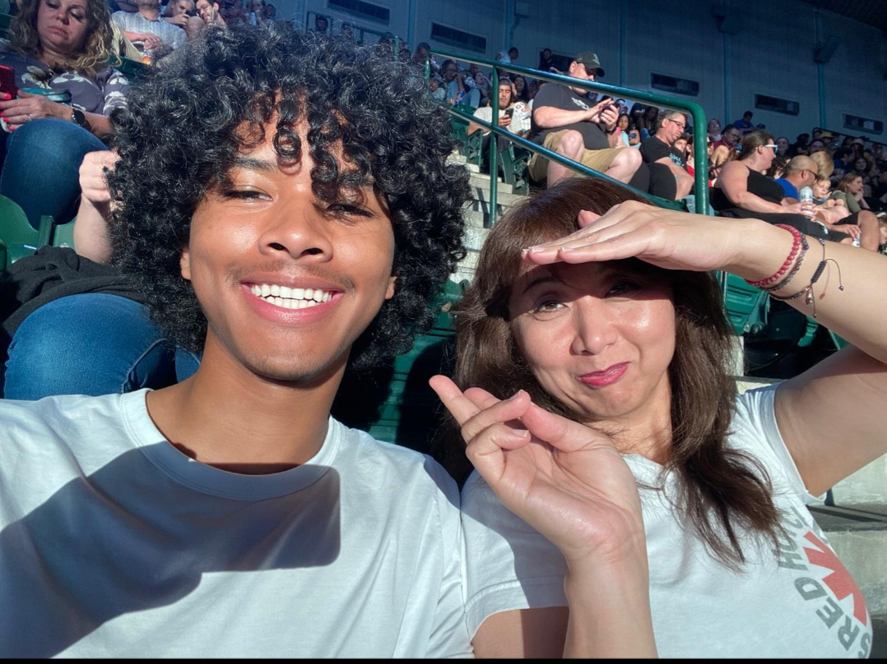

---
# Copy this file to write a journal entry for the About page.
# Name the copy after the entry, e.g. 2026-10-garden.md
title: "Miscellanous"
date: 2026-10-25
summary: "brief!"
# cover: "./photo.jpg"     # for a folder entry: journal/2026-10-garden/index.md + photo.jpg
# coverAlt: "What the photo shows"
tags:
  - life
# draft: true
---

Hi!! As I mentioned before my name is Afolabi. because this will be my first entry I'll just keep it light and share a little about myself. not toooooo much but just enough I suppose...

I really enjoy reading. I mean really really enjoy reading. Recently I've been really interested in reading East asian translated novels or webnovels.... Like Wuxia novels or Korean novels haha. Some of the books I've read that I really enjoyed are The Second Coming of Gluttony by Ro Yu-jin, A Will Eternal by Er Gen, and Got Dropped in a Ghost Story, Still Gotta Work by Baek Deok-su. just to name a few lol 

But other than reading I enjoy spending a lot of time with my family and friends either watching films, eating good food, or chatting about important social or economic topics. heavy on the last one-- I think its important to speak about societal problems and realities as much and often as possible as its important not only to us but to those around us and to everyone else who lives on this Earth... ahem well yep that's a short intro to me-- 

works I also really enjoy: Ghibli movies, FromSoftware graphic masterpieces, and (recently) Cyberpunk Edgerunners!!!

